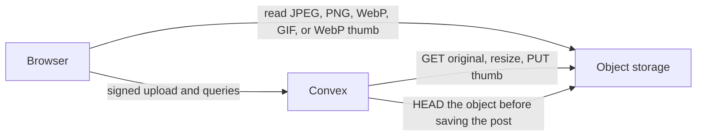
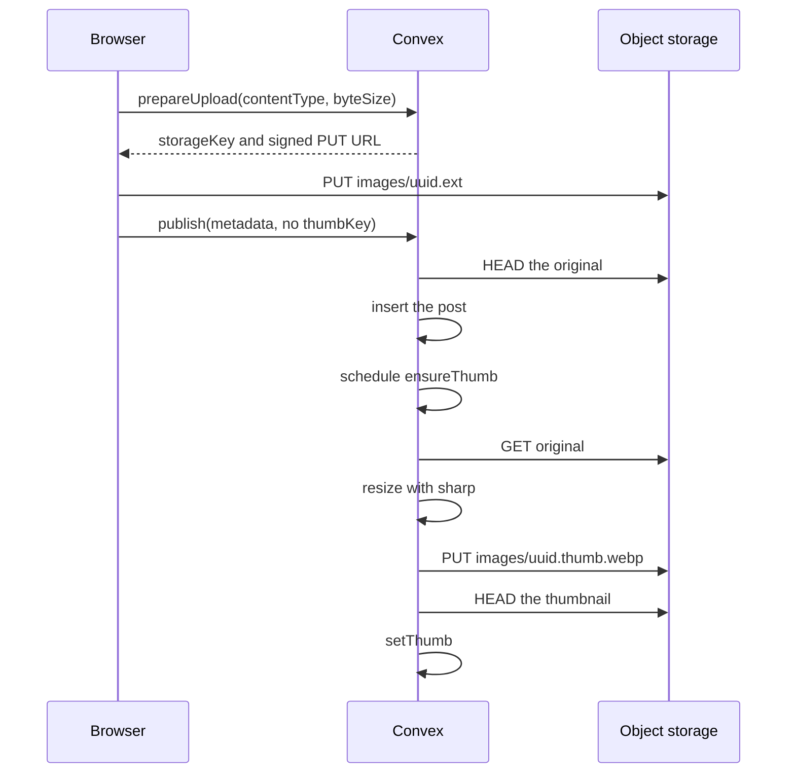
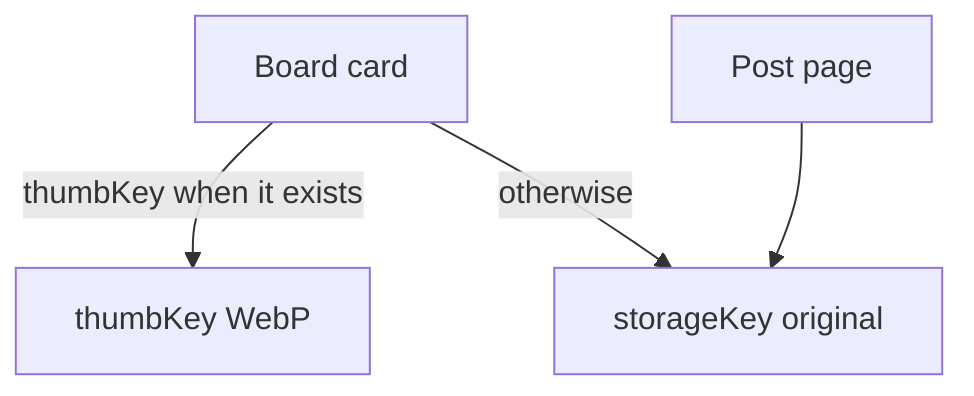

# How pictures move through Kura

Convex owns the post, the storage key, the account, and retries. Picture bytes stay in object storage. `ensureThumb` in `convex/storage.ts` writes the board thumbnail with sharp and puts it back in the same bucket.

The bucket is `kura-images`. In development that is s3rver on `http://127.0.0.1:9000`, with files under `D:\kura-minio\data`. Containers reach it at `http://host.docker.internal:9000`. The browser uses `VITE_S3_PUBLIC_URL`, which defaults to `http://127.0.0.1:9000/kura-images`.

## Upload

A contributor, moderator, or owner adds a JPEG, PNG, WebP, or GIF under 20 MB. Members can save pictures and edit their own preferences. Moderators and the owner can remove someone else's post. The role lives on the account and is not part of the preferences form. The browser does not resize the file.

`prepareUpload` signs the original only. `publish` checks the key, the content type, and the byte size, then inserts the post. When `thumbKey` is absent, it schedules `ensureThumb`.

`ensureThumb` is an internal Node action in `convex/storage.ts`. It downloads the original, resizes it with sharp, and PUTs the WebP. On success it HEADs the WebP and runs `setThumb`. A missing post after the resize schedules deletion of that thumb key. A picture sharp cannot read is logged and left without `thumbKey`, so the board keeps showing the original. A storage error is retried after 2s, 15s, and 60s.

`setThumb` is the only write of `thumbKey` after insert. It does nothing if the post is gone or the thumb is already recorded, and it rejects a key that is not `thumbKeyFor(storageKey)`.

## The thumbnail

`ensureThumb` downloads the original from the bucket and resizes it with sharp. Sharp applies EXIF orientation, keeps the longest edge at most 480, writes WebP at quality 80, keeps the first frame only, and strips metadata. The action PUTs `images/.../*.thumb.webp` back to the same bucket. The thumb key drops the extension and adds `.thumb.webp`, the same rule as `thumbKeyFor` in `shared/storage.ts`.

`convex.json` lists `sharp` in `node.externalPackages`. Convex installs that package when the functions are pushed. The same function runs on the self-hosted Docker backend and on Convex Cloud. On a server, functions reach MinIO at `http://minio:9000` via `KURA_S3_ENDPOINT`.

## What the board and the post page read

The board loads 48 cards at a time with `usePaginatedQuery`. Saved posts use `favorites.by_user_createdAt`. A tag filter uses `postTags.by_tag_createdAt` on the first tag. Text with no tag uses the `search_posts` search index and shows relevant matches. The safe feed uses `posts.by_rating_createdAt`. All ratings use `by_createdAt`. Extra filters run after the page is read, and the client asks for another page until it has 48 matches or the cursor is done.

Public reads stay public. Saving a picture and writing preferences require a signed-in user. Uploading requires a contributor, moderator, or owner. Deleting a post removes the Convex rows, then `deleteStored` deletes the original and the thumb from object storage. The author can delete their own post. A moderator or the owner can delete any post.

## Seed and migrate

`pnpm seed` imports a broad general-rated Safebooru catalog. `--board` adds Danbooru, Yande.re, Konachan, or Gelbooru, and `--preset nsfw` asks for questionable and explicit posts. An object already in the bucket is reused. A missing original is downloaded and PUT. Seed uploads original pictures. `importBatch` schedules `ensureThumb`, which writes the thumbnail. Ids already stored for that board are skipped. Posts tagged as minors are skipped.

`pnpm accounts` signs up the twelve local accounts, writes each profile and saved set, and attributes posts that still have the import author. New accounts with those emails receive the same role. Everyone else is a member.

`pnpm migrate` walks posts with the admin key and fills `searchText` and tag order. A post that still has no `thumbKey` gets its thumbnail from `ensureThumb` in `convex/storage.ts`.

## What Convex does not do

Convex file storage is not used for pictures. There is no Redis copy of a thumbnail, and there is no public route that encodes an arbitrary URL. The browser does not resize the file. Seed uploads the original, and `ensureThumb` writes the thumbnail. A normal upload is scheduled by Convex.
