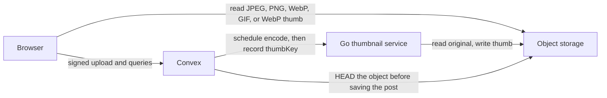
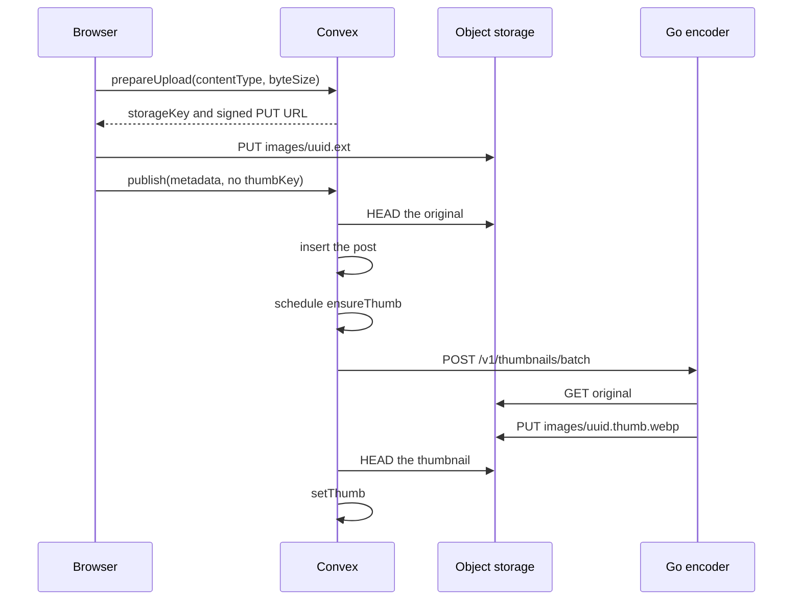
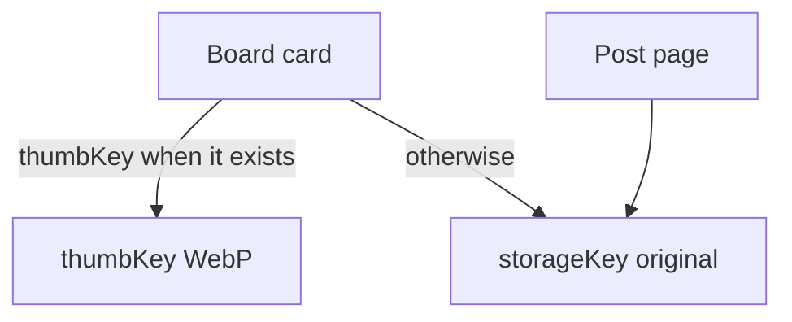

# How pictures move through Kura

Convex owns the post, the storage key, the account, and retries. Picture bytes stay in object storage. A Go process encodes the board thumbnail and never talks to the browser or to the Convex admin key.

The bucket is `kura-images`. In development that is s3rver on `http://127.0.0.1:9000`, with files under `D:\kura-minio\data`. Containers reach it at `http://host.docker.internal:9000`. The browser uses `VITE_S3_PUBLIC_URL`, which defaults to `http://127.0.0.1:9000/kura-images`.

## Upload

A contributor, moderator, or owner adds a JPEG, PNG, WebP, or GIF under 20 MB. Members can save pictures and edit their own preferences. Moderators and the owner can remove someone else's post. The role lives on the account and is not part of the preferences form. The browser does not resize the file.

`prepareUpload` signs the original only. `publish` checks the key, the content type, and the byte size, then inserts the post. When `thumbKey` is absent, it schedules `ensureThumb`.

`ensureThumb` is an internal Node action. It calls `KURA_THUMB_URL` (default `http://thumbnails:8080`) with `Authorization: Bearer` and the shared `KURA_THUMB_SECRET`. On success it HEADs the WebP and runs `setThumb`. A missing post after encode schedules deletion of that thumb key. Failures retry after 2s, 15s, and 60s. A 4xx from the service stops the retries. Until `thumbKey` is set, the board shows the original.

`setThumb` is the only write of `thumbKey` after insert. It does nothing if the post is gone or the thumb is already recorded, and it rejects a key that is not `thumbKeyFor(storageKey)`.

## The Go encoder

`pnpm thumbs` starts the Compose service `thumbnails` (profile `thumbs`) and publishes port 5006. The container listens on 8080. It has MinIO credentials and the shared secret. It does not have the Convex admin key.

| Route | Auth | Behavior |
| --- | --- | --- |
| `GET /health` | no | Process is up |
| `GET /v1/supported` | bearer | Still images and video extensions the encoder accepts |
| `POST /v1/thumbnails/batch` | bearer | 1–20 keys. Always HTTP 200, with `ok` and `failed` per key |

Accepted keys are `images/<uuid>.<ext>` and `images/<board>/<id>.<ext>` for safebooru, danbooru, gelbooru, konachan, and yandere. The thumb key drops the extension and adds `.thumb.webp`, the same rule as `thumbKeyFor` in `shared/storage.ts`. An existing thumb between 1 byte and 2 MB is returned as-is unless `force` is set.

Stills use libvips: longest edge 480, first frame, WebP quality 80, metadata stripped. GIF and WebP can keep animation when `animate` is set. `mp4`, `webm`, and `mov` use ffmpeg for one frame, then libvips. The upload form still accepts only still images.

## What the board and the post page read

The board loads 48 cards at a time with `usePaginatedQuery`. Saved posts use `favorites.by_user_createdAt`. A tag filter uses `postTags.by_tag_createdAt` on the first tag. Text with no tag uses the `search_posts` search index and shows relevant matches. The safe feed uses `posts.by_rating_createdAt`. All ratings use `by_createdAt`. Extra filters run after the page is read, and the client asks for another page until it has 48 matches or the cursor is done.

Public reads stay public. Saving a picture and writing preferences require a signed-in user. Uploading requires a contributor, moderator, or owner. Deleting a post removes the Convex rows, then `deleteStored` deletes the original and the thumb from object storage. The author can delete their own post. A moderator or the owner can delete any post.

## Seed and migrate

`pnpm seed` imports a broad general-rated Safebooru catalog. `--board` adds Danbooru, Yande.re, Konachan, or Gelbooru, and `--preset nsfw` asks for questionable and explicit posts. An object already in the bucket is reused. A missing original is downloaded and PUT, then the script asks `http://127.0.0.1:5006` for the thumb when that thumb is not already stored. If the encoder fails, the post is still imported and the board falls back to the original. Ids already stored for that board are skipped. Posts tagged as minors are skipped.

`pnpm accounts` signs up the twelve local accounts, writes each profile and saved set, and attributes posts that still have the import author. New accounts with those emails receive the same role. Everyone else is a member.

`pnpm migrate` walks posts with the admin key, fills `searchText` and tag order, then batches any post that still has no `thumbKey` through the same host encoder and `setThumb`.

## What Convex does not do

Convex file storage is not used for pictures. Actions do not resize bytes. There is no Redis copy of a thumbnail, and there is no public route that encodes an arbitrary URL. The browser never calls the Go service. Seed and migrate call it from the host only because they run outside the Convex network. A normal upload is scheduled by Convex.
